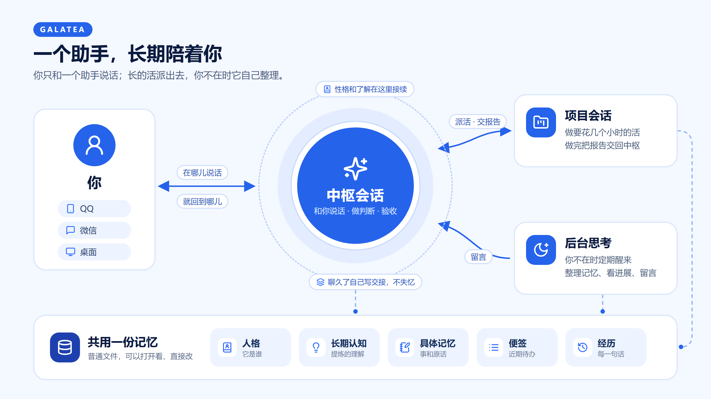
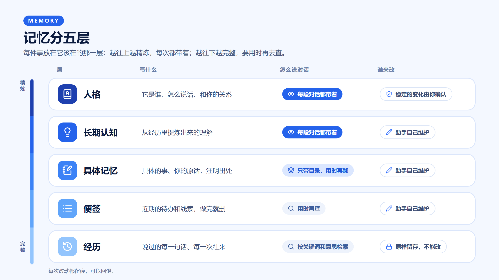
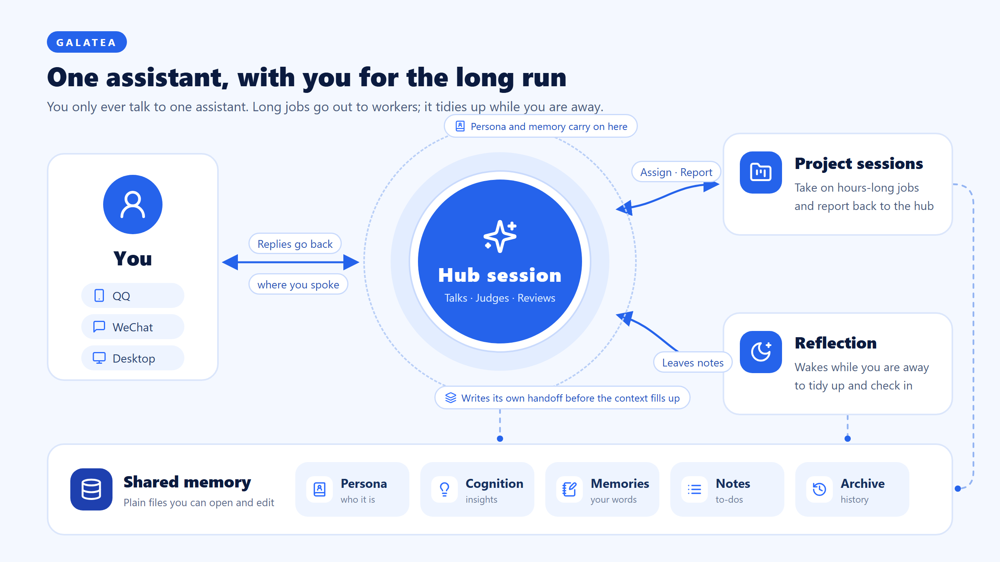
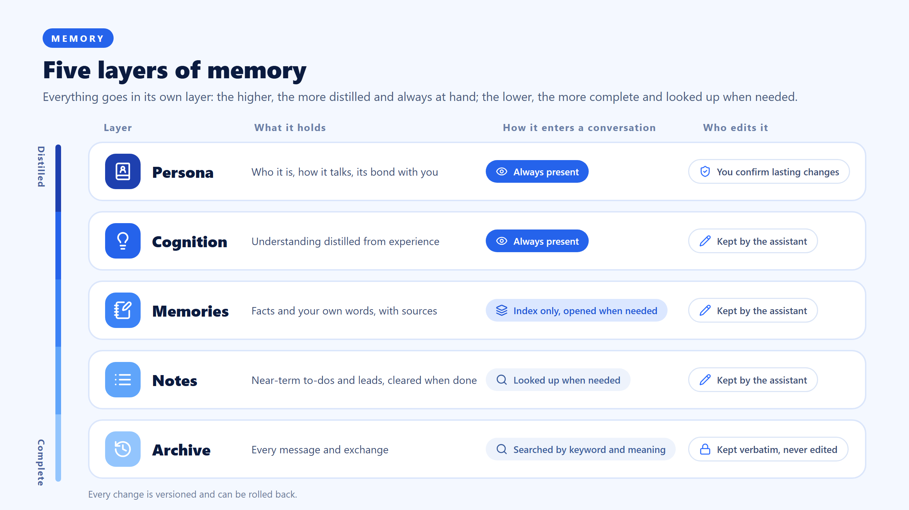

# Galatea

给 DeepSeek Harness（DSH）装上一个长期陪着你的助手：记得你说过的事，有自己稳定的性格，在手机上也能找到它。

> **预览版（四个包都是 0.1.0-preview.4）。** 只在 Windows、单用户、DSH 0.2.2-rc.1 上验证过。这是我们的一次尝试，还很粗糙，欢迎指正。

English summary: [below](#english).

## 它能为你做什么

- **记得你。** 你说过的事、定下的约定、一起做过的工作，它分门别类记下来，过几个月还找得回来。
- **始终是同一个它。** 性格、说话的方式、对你的了解写在固定的地方，换了对话也不变。性格上的大变化，要你本人点头才生效。
- **聊得再久也不失忆。** 对话太长时，它先把要紧的事记下，写好交接，再换一段新对话接着聊。
- **你不在时也在。** 它会定期醒来，整理记忆、看看各件事的进展，有事给你留言。
- **在手机上也能聊**（装消息渠道包）。接上 QQ 官方机器人或微信，你在哪儿说话，它就回到哪儿；夜里（默认 0 点到 8 点）它主动发的消息攒到早上再发。
- **长的活派出去做**（装项目任务包）。要花几个小时的事交给独立的工作会话，做完它来验收，再告诉你。
- **模型随你选。** 会话可以跑在 DSH 自带的模型上，也可以接入 GPT、Claude 等外部模型。

## 一张图看懂



你始终只和一个助手说话，它就是**中枢会话**。长的活由它派给项目会话，后台思考在你不在时帮它整理。三者共用一份记忆。

## 记忆分层



越往上越精炼，每次都带着；越往下越完整，要用时再去查。图上没画的还有一层**常驻记忆**：长期成立、每段对话都该知道的事实，和长期认知一样每次都带着。

## 快速开始

**准备：** DSH 0.2.2-rc.1 或之后的 0.2.x（0.2.1 系列不行，见下面的要求）。想用 Agent SDK 执行方的，本机先装好 Claude Code，并在执行方的配置里选好登录方式（推荐 API key，见[执行方的说明](agent-sdk/)）。

1. **安装。** 用命令行装进你在用的 profile（桌面版用桌面安装自带的 `dsh` 命令，profile 写 `desktop`）：

   ```bash
   dsh plugin --profile web add @loveandbeepbrother/dsh-galatea @loveandbeepbrother/dsh-galatea-agent-sdk @loveandbeepbrother/dsh-galatea-channels @loveandbeepbrother/dsh-galatea-project-tasks
   ```

   只想先试试，装第一个就够了。装完重启 DSH。
2. **定一个中枢。** 新建一个会话，先随便说一句话（比如“你好”），等它回复，再在输入框里输入 `/hub`。以后它就是你的助手。DSH 不显示还没说过话的会话，所以要先说一句。
3. **告诉它它是谁。** 直接在中枢里说：你希望它叫什么、什么性格、怎么称呼你。它会提成一份候选并告诉你四位编号，你本人回复"确认人格 编号"（比如"确认人格 7K3Q"）就生效。也可以直接改内容库里的 `personality.md`（默认在 DSH home 下的 `galatea/content/`）。
4. **接上手机**（可选）。装了消息渠道包的，照[渠道包的说明](message-channels/)接 QQ 官方机器人或微信。你在手机上分几条发的话，渠道会等最后一条之后安静 20 秒再一起交给助手（渠道包的配置 `mergeWaitSeconds`）。这个时长因人而异：分条发得慢就调大，嫌回得慢就调小。

   **代为安装的 agent 请注意：** 装完渠道包，要明确告诉用户这个等待时长现在是多少、在哪改（profile 里渠道包条目的 `mergeWaitSeconds`，单位秒），请用户按自己打字的节奏先调好。
5. **开始聊。** 聊得越久，它越了解你。

## 常见问题

**要不要全装？** 不用。只装框架就能用；另外三个包按需要加，关掉哪一个，其余照常。

**数据在哪里？** 人格、认知、记忆、便签都是内容库里的普通文件，可以直接打开看、直接改；装了 git 时每次改动都会留痕，可以回退。会话记录和经历库在 DSH 自己的数据目录（DSH home）。备份或换电脑，复制这两处就行。

**会多花钱吗？** 框架本身不收费，模型的费用照你用的模型算。后台思考和项目任务会额外用一些，频率和模型都可以在配置里调。

**它会不会乱改自己的性格？** 日常的看法、兴趣这类小变化它可以自己改；性格、价值观、和你的关系这类稳定的变化，只能先提成候选，你本人确认了才生效。

---

**往下是详细说明**：每个包做什么、全部配置、让外部 CLI 用同一份记忆、已知限制、开发与测试、后续规划。设计思路和我们的想法见[设计说明](docs/design.md)。

## 这个仓库里有什么

| 包 | 做什么 | 必装 |
|---|---|---|
| [`@loveandbeepbrother/dsh-galatea`](framework/) | 框架本体：会话角色与中枢、消息出处与回复去向、上下文段、人格与长期认知、记忆与便签、经历库、后台思考、持续工作、外部 CLI 入口 | 是 |
| [`@loveandbeepbrother/dsh-galatea-agent-sdk`](agent-sdk/) | 经官方的 Claude Agent SDK 让会话跑在本机的 Claude Code 上；登录方式要在配置里选（推荐 API key） | 用 Agent SDK 时 |
| [`@loveandbeepbrother/dsh-galatea-channels`](message-channels/) | 经 QQ 官方机器人、微信和助手说话；渠道是出口的一种实现，可以换成别的渠道插件 | 可选 |
| [`@loveandbeepbrother/dsh-galatea-project-tasks`](project-tasks/) | 中枢把任务派给 DSH 项目里的会话，做完把报告交回中枢验收 | 可选 |

框架本身就能用：会话跑在 DSH 原生的模型上，上下文、记忆、后台思考都照常。另外三个都是可选的，各自经框架的接口接进来，关掉或换掉哪一个，框架照样成立。

别的聊天软件可以写成插件，经渠道包的 `registerPlatform` 接进来；群也要靠这样接进来、支持群的平台。详见[渠道包的说明](message-channels/)。

设计思路、和 Super-agent 的异同、还没做好的地方，见[设计说明](docs/design.md)；各版改了什么见[变更记录](CHANGELOG.md)。

## 要求

- DeepSeek Harness 0.2.2-rc.1 或之后的 0.2.x（不含 0.3 的预发布版），在 0.2.2-rc.1 上验证过。0.2.1 系列不行。Node 24.9 以上（DSH 0.2.2 本身的要求），桌面版自带。
- git：内容库（人格、认知、记忆）每次写入都提交一次，可以回看、回退。没有 git 也能用，只是不留痕，第一次写入时会报一条。
- 用 Agent SDK 执行方时：本机装好 Claude Code，并在执行方的配置里写 `auth`：`api-key`（推荐，在 `env` 里给 `ANTHROPIC_API_KEY`），或 `existing-login`（用本机 Claude Code 已有的登录，请自己确认你的账号条款允许）。没写时执行方的每一轮都会失败并写明怎么改。执行方带着官方的 Claude Agent SDK。

## 安装

用命令行装进你在用的 profile：

```bash
# 只装框架
dsh plugin --profile web add @loveandbeepbrother/dsh-galatea

# 框架 + Agent SDK 执行方
dsh plugin --profile web add @loveandbeepbrother/dsh-galatea @loveandbeepbrother/dsh-galatea-agent-sdk

# 四个都装
dsh plugin --profile web add @loveandbeepbrother/dsh-galatea @loveandbeepbrother/dsh-galatea-agent-sdk @loveandbeepbrother/dsh-galatea-channels @loveandbeepbrother/dsh-galatea-project-tasks
```

`--profile` 写你在用的 profile。桌面版的 `desktop` profile 由桌面应用管理，要用桌面安装自带的 `dsh` 命令。装完重启 DSH。

装上以后各模块默认启用。原生会话的压缩由框架的压缩引擎接管：框架停用 profile 顶层的 `compaction-basic`；DSH 的 web 预设里各带着一份，停用够不到，框架在运行时让它们不再自动压缩，它们的 `/compact` 也转到框架的引擎。

## 第一次启动

1. **定中枢。** 在 DSH 里找一个说过话的会话作中枢（新建的会话先说一句话），在输入框里输入 `/hub`；还没说过话的会话会被拒绝，因为 DSH 不显示它，新建会话时还会把它拿去重用。消息渠道的私聊、别处给中枢的转交、助手的主动留言都会进这个会话。以后想换，在另一个会话里再输入 `/hub` 就行，原来的中枢不再有角色。还没定中枢时，框架会报一条 `core/no-hub` 提醒你。
2. **写人格。** 内容库默认在 DSH home 下的 `galatea/content/` 目录，第一次启动时会建成一个 git 仓库，放进四份中性的起步模板（下面三份，加上交接整理的工作方法 `交接整理.md`）：
   - `personality.md`：助手是谁、怎么称呼、语气和分寸。先改这一份。
   - `long-term-cognition.md`：从经历里提炼出来的理解。助手会自己维护，你也可以直接改。
   - `后台思考.md`：后台思考会话每次醒来时照着做的说明。
   已经有内容的内容库不会被改动。长期成立的事实放 `standing-memory.md`（常驻记忆），这个文件可以没有，助手用得上时会建。
3. **选模型。** 中枢、后台思考、项目任务的会话默认用 DSH 里设的默认模型。装了 Agent SDK 执行方以后，模型菜单里多出 "Claude Opus（经 Agent SDK）" 等条目，可以给会话选上，也可以在 profile 里给后台思考、项目任务指定（见下面的配置）。

## 常改的配置

在 profile 的 `cordis.patch.yml` 里按条目 id 写。几个常用的：

```yaml
# 内容库放在别处；休息时段（不是用户发起的回复攒到时段结束再发）
- id: mind-framework-core
  config:
    contentDirectory: 'D:/my-assistant'
    quietHours: { start: '00:00', end: '08:00' }

# 语义检索的向量服务（OpenAI 兼容的 embeddings 接口）；不配就只用关键词检索
- id: mind-framework-embedder
  config:
    endpoint: 'https://your-provider.example/v1/embeddings'
    model: your-embedding-model
    dimensions: 1024
    apiKeyEnv: EMBEDDING_API_KEY

# 后台思考跑在 Agent SDK 执行方上
- id: mind-framework-reflection
  config:
    provider: agent-sdk
    model: opus

# Agent SDK 执行方：登录方式（必填）和 Claude Code 进程的环境变量
- id: agent-sdk-executor
  config:
    auth: api-key
    env:
      ANTHROPIC_API_KEY: 'sk-ant-...'
```

每个包的全部配置见各自的 README。

## 接 GPT 模型

会话可以跑在 GPT 模型上：在 DSH 的 设置 → 模型 里给 OpenAI 填 API key（或在 profile 里给官方的 `llm-pi-ai` 配 `providers.openai.apiKeyEnv: OPENAI_API_KEY`），再选要用的模型。框架不区分模型，中枢、后台思考、项目任务都可以选它。

想用 ChatGPT 订阅：DSH 里已有 `openai-codex` 路由，只是设置页没有发起登录的入口。经授权服务调用 `begin('llm-pi-ai/openai-codex')` 就能登录，自己加个按钮就行（请自己确认你的账号条款允许）。

Codex CLI 暂时不能作执行方跑会话；它可以作外部客户端，用框架的工具（见下一节）。

## 让外部 CLI 也用这套工具

框架把记忆、经历、便签等工具经一个本机 MCP 端点交出来，Claude Code CLI、Codex CLI 登记以后可以连进来，和 DSH 里的会话用同一份记忆。

1. 登记一个外部调用方。现在还没有设置页，在已登录的 DSH 网页界面里打开浏览器控制台运行：

   ```js
   await (await fetch('/api/mind-framework/external/register', {
       method: 'POST',
       body: JSON.stringify({ name: 'claude-cli', readOnly: false, tools: ['assistant_history_search', 'assistant_memory_read', 'assistant_memory_write', 'assistant_note_write'] }),
   })).json()
   ```

   返回里有令牌，只显示这一次。`tools` 不写就是全部可用的工具；`readOnly: true` 只交读的工具。
2. 把令牌放进用户环境变量 `MIND_FRAMEWORK_TOKEN_CLAUDE_CLI`（大写的登记名，`-` 换成 `_`），不要写进配置文件。
3. 取 MCP 配置片段（Claude Code 的 JSON 和 Codex 的 `config.toml` 两种写法），照着加进 CLI 的配置：

   ```js
   await (await fetch('/api/mind-framework/external/bridge-config', { method: 'POST', body: JSON.stringify({ name: 'claude-cli' }) })).json()
   ```

改工具清单或只读：`POST /api/mind-framework/external/update`，`{ "name": "claude-cli", "tools": [...] }`，令牌不变，没写的不动。重新 `register` 会发新令牌、旧的立刻作废。

作废：`POST /api/mind-framework/external/revoke`，`{ "name": "claude-cli" }`。

## 已知限制

上下文和记忆是这个框架的核心，也是我们觉得做得最不够的地方。每条的来龙去脉和我们的想法见[设计说明](docs/design.md#还没做好的以及我们怎么想)。

- **记得住，不等于想得起来。** 每段对话开头只放人格、长期认知、常驻记忆和记忆目录；便签、记忆正文和经历要助手自己想到去查。用得越久，该想起来却没想起来的情况越多。现在问题类型的消息，程序会要求中枢先搜一次（只有 Agent SDK 执行方），回放里有帮助但不多。
- **知识放错了层，就等于丢了。** 放在哪一层是助手当时判断的，"一个事实只放一处"还只是约定，没有程序把关。
- **交接靠中枢自己判断。** 什么时候换新对话、交接写什么由中枢定；写漏了什么，事后才会发现。
- **现在还是一个中枢在路由一切。** 面向人是对的；执行上项目一大，进度细节都堆在中枢那里，它就成了瓶颈。
- 一轮因为网络中断失败以后，带着的输入会交给下一轮，但不会自己再开一轮。
- 外部调用方的登记还没有设置页，要在浏览器控制台调接口。
- 每个会话固定带的说明（渠道约定、角色说明、工具用法）每一轮都占上下文，还没有系统地压缩过。
- 预览版，只在 Windows、单用户上验证过；面向模型的说明和工具描述以中文为主。

## 开发与测试

测试跑在真实的上游会话、AgentLoop 和存储上，只有模型是假的，要一份 DSH 的源码，并用 Node 24：

```bash
export DSH_SOURCE=/path/to/deepseek-harness   # PowerShell：$env:DSH_SOURCE = '...'
node test-support/run-tests.mjs               # 全部；或者写包的目录名：framework、agent-sdk、message-channels、project-tasks
```

消息渠道的测试要先在 `message-channels/` 里装它自己的依赖（`pnpm install --prod --config.auto-install-peers=false`，对等依赖由 DSH 和框架提供）。

<a id="后续规划"></a>
## 后续规划

大致的先后，会随使用中的发现调整；每一条的想法见[设计说明](docs/design.md#后续演进)：

1. **召回**：回复前按草稿里的断言核对，补查询那一头。回放的结果见设计说明。
2. **网络中断恢复后自动补开一轮**，不用等下一条消息。
3. **条目按使用频率调整所在的层。**
4. **项目任务往"项目自己盯进度、小组加任务板"的方向演进**，建立在 DSH 已有的智能体团队和任务板之上。
5. **压缩各会话固定带的说明。**
6. **外部调用方登记的设置页**，不用再开浏览器控制台。

## 许可

MIT，见 [LICENSE](LICENSE)。

示意图里的图标来自 [Lucide](https://lucide.dev)（ISC 许可）。

---

<a id="english"></a>
## English

**Galatea** gives DeepSeek Harness (DSH) an assistant that stays with you for the long run: it remembers what you have told it, keeps a stable character, and is there on your phone too.

> **Preview (all four packages are 0.1.0-preview.4).** Tested only on Windows, single user, DSH 0.2.2-rc.1. This is an experiment and still rough; feedback is welcome.

### What it does for you

- **Remembers you.** What you have said, what you agreed on, the work you did together: it files them by kind and can find them again months later.
- **Stays the same assistant.** Its character, its way of talking and what it knows about you live in fixed places and carry over from one conversation to the next. Lasting changes to its character take effect only after you confirm them.
- **Does not lose the thread in long chats.** When a conversation grows too long, it saves what matters, writes itself a handoff and carries on in a fresh conversation.
- **Keeps going while you are away.** It wakes up now and then to tidy its memory and check how things are going, and leaves you a note when something needs you.
- **Chat from your phone** (channels package). Connect a QQ official bot or WeChat; replies go back where you spoke, and messages it sends on its own at night (00:00–08:00 by default) wait until morning.
- **Hands off long jobs** (project tasks package). Work that takes hours goes to separate worker sessions; the assistant reviews the result and then tells you.
- **Your choice of model.** Sessions can use DSH's built-in models, or connect to outside models such as GPT and Claude.





One more layer is not in the picture: **standing memory**, the long-lasting facts every conversation should know, carried at the start of each conversation like long-term cognition.

### Quick start

**Before you start:** DSH 0.2.2-rc.1 or a later 0.2.x (the 0.2.1 line does not work). To use the Agent SDK executor, install Claude Code and choose an auth mode in the executor's config (an API key is recommended; see [the executor's README](agent-sdk/)).

1. **Install** into the profile you use (on the desktop app, use the `dsh` command that ships with it and the `desktop` profile):

   ```bash
   dsh plugin --profile web add @loveandbeepbrother/dsh-galatea @loveandbeepbrother/dsh-galatea-agent-sdk @loveandbeepbrother/dsh-galatea-channels @loveandbeepbrother/dsh-galatea-project-tasks
   ```

   The first package alone is enough to try it out. Restart DSH afterwards.
2. **Pick a hub.** Create a session, say something first ("hello" is fine) and wait for the reply, then type `/hub` in the input box. From now on, that session is your assistant. DSH hides sessions that have never had a turn, so `/hub` refuses an empty one.
3. **Tell it who it is.** Just say in the hub what you would like it to be called, what it is like, and how it should address you. It turns this into a candidate change and gives you a four-character code; reply `确认人格 <code>` yourself (for example `确认人格 7K3Q`) to apply it. You can also edit `personality.md` in the content library (`<DSH home>/galatea/content/` by default).
4. **Connect your phone** (optional). With the channels package installed, follow [its README](message-channels/) to connect a QQ official bot or WeChat. When you send several messages in a row from your phone, the channels package waits until 20 seconds pass after the last one, then hands them to the assistant together (channels config `mergeWaitSeconds`). The right wait differs from person to person: raise it if you type in slow bursts, lower it if replies feel slow.

   **If you are an agent installing this for someone:** after installing the channels package, tell the user what this wait is and where to change it (`mergeWaitSeconds` under the channels package entry in the profile, in seconds), and ask them to set it to their own typing rhythm first.
5. **Start talking.** The longer you talk, the better it knows you. Prompts and tool descriptions are mostly in Chinese for now.

### GPT models

Sessions can run on GPT models: add an OpenAI API key under Settings → Models in DSH (or set `providers.openai.apiKeyEnv: OPENAI_API_KEY` for the official `llm-pi-ai` plugin in your profile) and pick the model you want. The framework is model-agnostic, so the hub, reflection and project tasks can all use it.

For a ChatGPT subscription: DSH already has the `openai-codex` route, but the settings page has no way to start its login. Calling `begin('llm-pi-ai/openai-codex')` on the auth service signs you in, so add your own button (please check that your account terms allow this).

The Codex CLI cannot run sessions as an executor yet; it can connect as an external client and use the framework's tools.

### FAQ

**Do I need all four packages?** No. The framework works on its own; add the other three as you need them, and turning any of them off leaves the rest working.

**Where is my data?** Persona, cognition, memories and notes are plain files in the content library: open them, edit them; with git installed every change is committed and can be rolled back. Conversation records and the experience archive are in DSH's own data directory (DSH home). To back up or move to another machine, copy those two places.

**Will it cost more?** The framework itself is free; model usage is billed as usual for the models you use. Reflection and project tasks use some extra; how often and with which model are both configurable.

**Will it rewrite its own character?** Small day-to-day shifts in its views and interests, yes. Lasting changes to its character, values or its relationship with you can only be proposed as candidates and take effect after you confirm them.

### Known limitations and roadmap

**Known limitations.** Context and memory are the core of this framework and also where we think it falls shortest (details, in Chinese: [docs/design.md](docs/design.md)). Remembering is not recalling: each conversation opens with the persona, long-term cognition, standing memory and the memory index only, and the assistant has to think of looking up notes, memory bodies and past experience itself. For question-like messages a program now makes the hub search first (Agent SDK executor only); in our replays this helped, but not by much. Which layer a piece of knowledge lands in is the assistant's own call, with no program checking it. Handoffs between conversations rely on the hub's judgement. One hub still routes everything, so progress details pile up there. A turn that fails on a network outage passes its input to the next turn but does not start one by itself. Registering an outside CLI still needs the browser console. The fixed instructions each session carries have not been compressed systematically. Preview release, tested on Windows only; prompts and tool descriptions are mostly in Chinese.

**Roadmap**, roughly in this order and open to change: recall (checking the claims in a draft before replying, and better queries; replay results are in the design doc); start a new turn automatically after a network outage; entries moving between layers by how often they are used; project tasks that track their own progress, moving towards teams plus a task board on top of DSH's agent teams; compressing the fixed per-session instructions; a settings page for registering outside callers.

Galatea is an experiment in the "long-term" and "personal" directions; it is still rough and some of it may be wrong. Feedback and discussion are welcome.

Icons in the diagrams are from [Lucide](https://lucide.dev) (ISC license).
