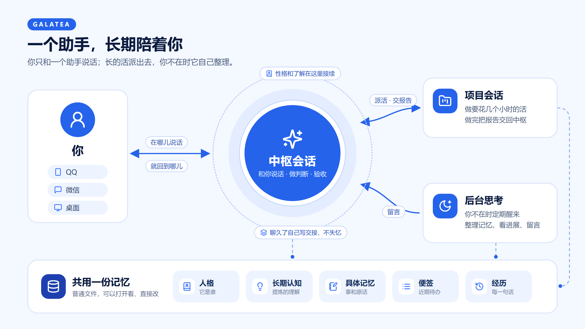
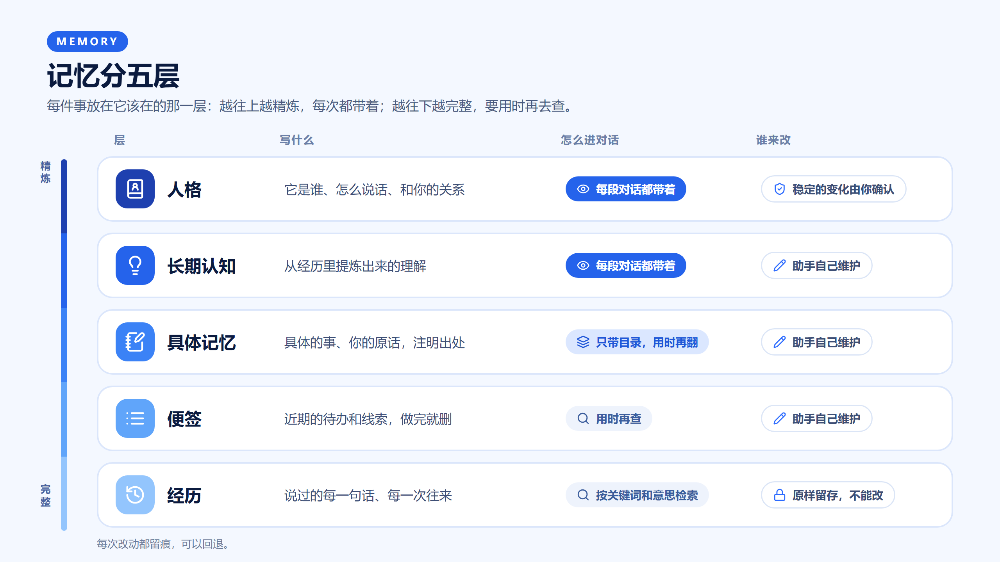

# @loveandbeepbrother/dsh-galatea

Galatea 的框架本体。完整说明见仓库 README：https://github.com/loveandbeepbrother/dsh-galatea





一个包里有十一个插件入口，每个入口是一个模块、提供一个服务，模块之间只经服务接口调用。装上以后全部启用；不要哪个，在 profile 里按 id 写 `disabled: true`，依赖它的地方会报出"某某没有加载，所以某某不可用"。

会话跑在什么模型上由 DSH 决定，框架不区分。

## 模块

| 条目 id | 服务 | 管什么 |
|---|---|---|
| `mind-framework-core` | `core` | 会话角色（中枢、工作会话、后台、外部调用方）、消息入口 `deliver` 与出处、分类与来源标注、每一轮的回复去向、附在下一轮的提醒、会话开头的上下文段、执行方登记、工具端点（MCP）、内容库、休息时段、异常出口 `report` |
| `mind-framework-context` | `context` | 用量提醒、交接与换新对话（会话一级：DSH 记录跟着落边界）、兜底压缩线、`land`（执行方压缩过以后请它落边界，要用 `by` 写明是哪个执行方；它已经切走就不落）、`recentTurns`（交接以后带的最近几轮原文，配置 `recentTurns`、`recentChars`） |
| `mind-framework-compaction` | `compaction` | 原生会话的压缩引擎（接管上游的 `compaction-basic`，包括 web 预设里各带的那几份）；替所有执行方在 DSH 记录里落边界（插件记录 `plugin:mind-framework/boundary` 写明种类）；外部执行方的会话不做 DSH 侧压缩，从它们切到原生时先写交接 |
| `mind-framework-mind` | `mind` | 人格、长期认知、常驻记忆、人格候选与确认（每一轮固定一个版本）；“我们之间”（单独一段，接在心智段后面） |
| `mind-framework-embedder` | `embedder` | 向量服务（OpenAI 兼容的 embeddings 接口）；不配就只用关键词检索 |
| `mind-framework-memory` | `memory`、`notes` | 具体记忆（一条一个文件、注明来源）、便签、检索 |
| `mind-framework-experience` | `experience` | 经历库：每一句输入、回复、跨会话消息按会话记成时间线；来源可以注册；检索；收藏；记忆、便签、文档、经历的使用统计（`assistant_usage`） |
| `mind-framework-search` | `search`、`searchFirst` | 一张派生索引（`search.sqlite`，能重建）、统一入口 `assistant_search`：经历、记忆、便签、文档、工具轨迹一起搜，关键词和向量两路合并，按来源分组；先搜再答（门控版，见 `search/first.js`） |
| `mind-framework-reflection` | `reflection`、`contact` | 后台思考的节奏、主动留言、交接整理 |
| `mind-framework-work` | `work` | 持续工作：一个目标跨轮、跨重启地推进，做完或卡住时回报发起方 |
| `mind-framework-external` | `externalEntry` | 把框架的工具经本机 MCP 端点开给外部 CLI |

异常：各模块经核心的 `report` 报。装了 Watchdog 这类消费方（`core.onReport`，可以用 `takes` 声明接手哪些类别），由它归并、提醒；没有消费方接手的类别，核心留最近 200 条，后台思考醒来时按类别计数交进事实段，不会只写进日志就没了。

`/hub` 命令由核心注册：在要作中枢的会话里输入它，这个会话就成为中枢。只有用户本人能发命令，模型调不到。还没开过轮的会话不行（DSH 不显示它，新建会话时还会拿它重用），要先在里面说一句话。

## 内容库

人格、长期认知、常驻记忆、记忆、便签和后台思考的模板都是内容库里的普通文件。内容库是一个 git 仓库，每次写入都提交一次，提交说明里写明是谁改的；工具以外的改动（你手改的，或者会话直接改了文件）程序分不出是谁做的，所以单独提交一次、作者写成“工具外改动”：要么在下次经工具写这个文件之前，要么等定时的整理（启动后一分钟一次，之后每半小时一次），先到哪个算哪个。

第一次启动、内容库还不是仓库时，框架建好仓库，写进四份中性的起步模板（`personality.md`、`long-term-cognition.md`、`后台思考.md`、`交接整理.md`）。常驻记忆 `standing-memory.md` 可以没有，按空算，也不报异常。已经是仓库的内容库不会被改动；文件缺了照常按"缺"处理，并报出来。

## 配置

只列常改的项，其余见各模块源码里的 `Config`。

**核心** `mind-framework-core`

| 项 | 默认 | 说明 |
|---|---|---|
| `contentDirectory` | DSH home 下的 `galatea/content` | 内容库目录；写成空字符串就不要内容库。经历库、发现文件放在上一层，不进内容库 |
| `quietHours` | 00:00–08:00，本机时区 | `{ start, end, timezone }`：不是用户发起的回复攒到时段结束再发 |
| `toolDeclarations` | 无 | 不认识框架的插件注册的工具的声明 `{ 工具名: { effect: read｜write, alwaysLoad } }`；`alwaysLoad: true` 让它经 MCP 端点常驻，不写就延后加载 |
| `externalCwd` | 用户主目录 | 外部调用方会话的工作目录 |

**向量** `mind-framework-embedder`：`endpoint`、`model`、`dimensions`、`apiKeyEnv`（密钥所在的环境变量名）。不配就只用关键词检索。

**经历库** `mind-framework-experience`

| 项 | 默认 | 说明 |
|---|---|---|
| `archiveFile` | DSH home 下的 `galatea/experience.sqlite` | 经历库文件 |

经历库默认只收 DSH 里的会话。别的插件可以经服务 `experience` 的 `registerSource({ id, label, category?, pull? })` 登记来源：
推送式来源自己 `append(entries, { replaceFrom?, ops? })`；拉取式来源给 `pull(cursor)`，经历库定时问它，它交回
`{ entries?, ops?, cursor }`，位置存在库里。一次拉取里要分几份文件各自重算的，在 `pull` 里逐份 `append`（`replaceFrom` 带 `part`），
最后只交回 `cursor`。读 JSONL 文件可以用 `parsers.readLines(path, offset, onLine)`，从字节位置续读。
别的来源的条目显示为“<来源的 label>「标题」（地方）”；条目带 `title` 时，这条时间线较早的条目跟着改成这个标题。

**心智** `mind-framework-mind`：`personaFile`（`personality.md`）、`cognitionFile`（`long-term-cognition.md`）、`standingFile`（`standing-memory.md`）、`personaMaxChars`、`cognitionMaxChars`（0 是不限）、`standingMaxChars`（默认 3000，超了照样写、返回值里写明；0 是不限）、`confirmTemplate`（确认人格候选的口令，默认"确认人格 {code}"）。

**后台思考** `mind-framework-reflection`

| 项 | 默认 | 说明 |
|---|---|---|
| `provider` / `model` | 空 | 后台思考会话用的模型；空就用 DSH 设的默认模型 |
| `templateFile` | `后台思考.md` | 后台思考的模板 |
| `defaultMinutes` / `minMinutes` / `maxMinutes` | 180 / 60 / 720 | 两次醒来的间隔：助手每次自己定，夹在范围里 |
| `contactPhrase` | 开启主动联系 | 用户本人说这句话，才打开主动留言 |

**外部入口** `mind-framework-external`：`discoveryFile`（默认 DSH home 下的 `galatea/endpoint.json`，桥按它找到端点）、`tokenEnvPrefix`（令牌所在环境变量的前缀，默认 `MIND_FRAMEWORK_TOKEN_`）。

## 工具怎么交给别的执行方

框架和插件的工具经核心登记，再经本机 MCP 端点交给别的执行方（比如 Agent SDK 执行方里的 Claude Code）：

- **默认延后加载。** 端点只让执行方知道工具名，模型要用时经工具搜索按名字或用途加载，插件装多了也不会把每段对话的开头占满。`initialize` 交回一段服务器说明（不到 600 字），告诉模型这组工具管什么、什么时候去搜。
- **声明了 `alwaysLoad: true` 的常驻**，每次请求都带着完整定义。框架自己只标了最常用的几个：`assistant_channel_send`、`assistant_session_send`、`assistant_note_write`、`assistant_search`、`assistant_context_handoff`，以及 DSH 的 `present`。统一搜索也常驻，藏起来模型容易不查就去问用户。
- 别的插件的工具一律走默认（延后）；要常驻就在核心的 `toolDeclarations` 里给它写 `alwaysLoad: true`。
- **升级以后，已经在进行中的对话沿用它原来的工具清单。** Claude Code 续接一段对话时，把这段对话原有的工具定义整份照旧发出：原来常驻的仍然常驻，不按新的延后设置重排；改了描述或参数的同名工具还是旧定义；已经删掉或改了名的工具也还在清单里，调用时服务端会报找不到。新加的工具照常按延后列出。换新对话（框架的交接）以后才按新的来，所以升级改了工具的版本以后，让在用的会话交接一次。
- **原生执行方不看这一项。** 原生能不能延后加载由 DSH 上游按模型提供方决定：DeepSeek 提供方把上游的 `deferLoading` 交给接口，pi-ai 的 Anthropic 路由在会话里补加；路由不支持增量更新时上游一律直接交出全部工具。框架不改原生的行为。

## 测试

跑在真实的上游会话、AgentLoop 和存储上，只有模型是假的（不联网）：

```bash
export DSH_SOURCE=/path/to/deepseek-harness
node test-support/run-tests.mjs framework
```

## 许可

MIT
